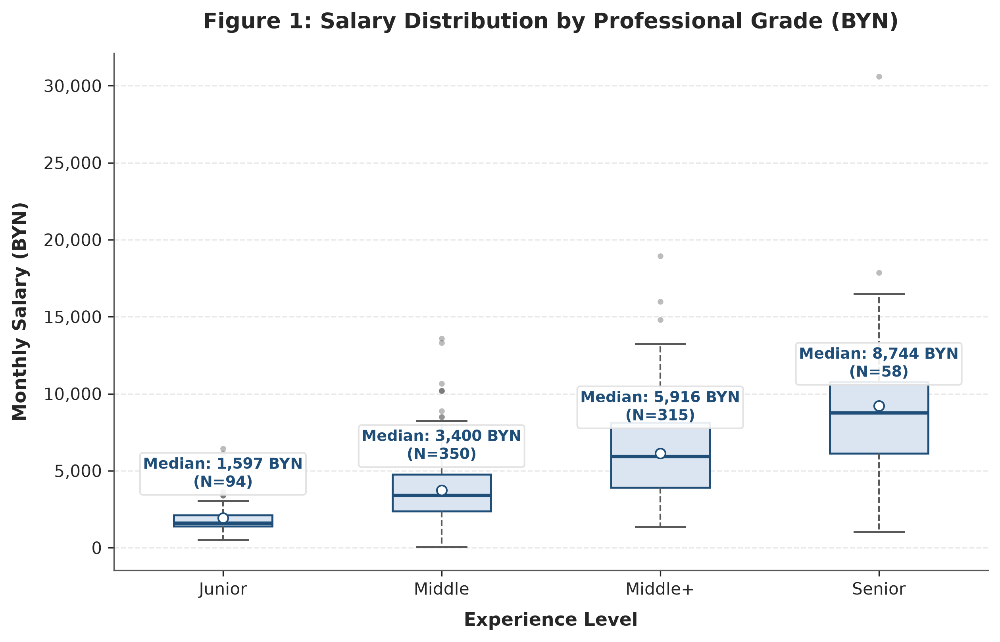
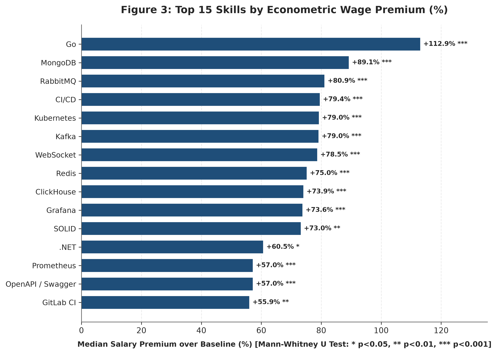
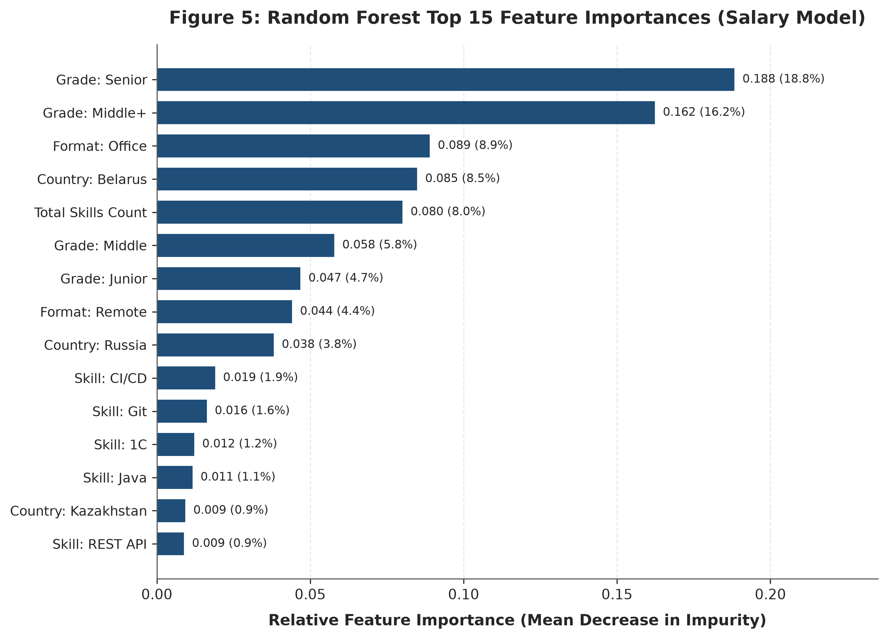
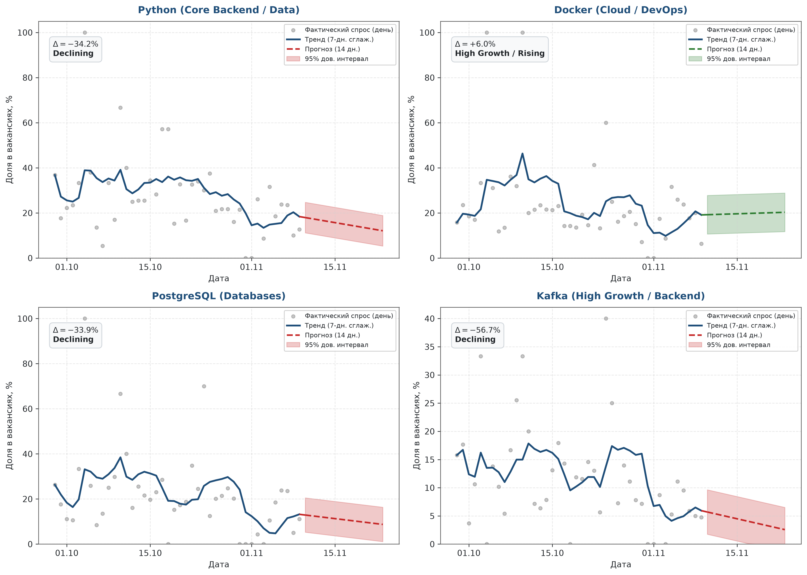
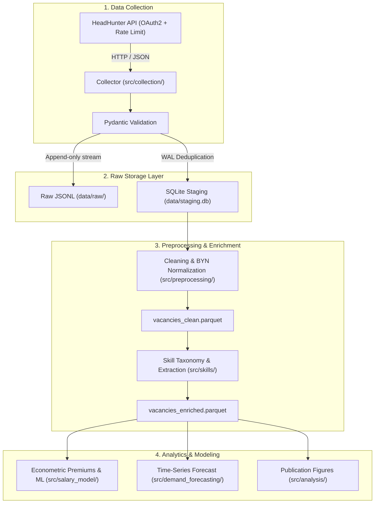

# JobPulse 📊


> **IT Job Market Analytics & Forecasting**  
> *Завершённое учебно-научное исследование рынка IT-вакансий стран СНГ средствами Python*

---

## 🎯 Научная тема исследования
> **«Автоматизированный анализ IT-вакансий СНГ средствами Python: оценка влияния навыков на заработную плату и прогнозирование спроса на них»**

Проект полностью реализован и включает:
1. **Научную работу**: статистическое и эконометрическое исследование связи технологических навыков с компенсацией и динамики спроса (см. [`docs/scientific_paper.md`](docs/scientific_paper.md) и `Статья_JobPulse_Тарасевич_Банников.pdf`).
2. **Воспроизводимый Data/ML-пайплайн**: сбор данных с HeadHunter API, неизменяемое хранение (JSONL + SQLite WAL), нормализация валют в BYN, извлечение навыков по таксономии, обучение моделей зарплат (`Ridge`, `Random Forest`) и прогнозирование временных рядов спроса (`Holt Linear Trend`).
3. **Публикационную аналитику**: автоматическая генерация 6 графиков в [`reports/figures/`](reports/figures/) и 148 модульных/интеграционных тестов (`pytest`).

---

## 📈 Ключевые результаты исследования

Исследование проведено на выборке из **2 472** уникальных IT-вакансий СНГ за 42 дня (`2026-09-29` — `2026-11-09`), из которых **817** содержат явную вилку заработной платы (разбиение train/test: `653 / 164`, **61** признак).

### 1. Моделирование заработных плат (`src/salary_model`)
| Модель | Test $R^2$ | Test MAE (BYN) | Test RMSE (BYN) | CV $R^2$ (mean ± std) |
|---|---:|---:|---:|---:|
| **Baseline (Dummy)** | -0.1479 | 2 392.87 | 3 183.91 | -0.0820 ± 0.0245 |
| **Ridge Regression** | 0.4556 | 1 666.38 | 2 192.61 | 0.3384 ± 0.1304 |
| **Random Forest** | **0.5634** | **1 452.51** | **1 963.46** | **0.4588 ± 0.1035** |

Главные факторы стоимости специалиста по важности признаков (`Random Forest`): уровень опыта (`Senior` — 0.188, `Middle+` — 0.162), формат работы (`office` — 0.089, `remote` — 0.044), локация (`Беларусь` — 0.085, `Россия` — 0.038) и общее число требуемых навыков (`skills_count` — 0.080).

### 2. Эконометрическая оценка премий за навыки
Из **44** оценённых технологий **26** показали статистически значимую премию к медианной зарплате ($p < 0.05$). Топ-5 по относительной премии:
- **Go**: `+112.86%` (`+4 506.70 BYN`, $p = 3.2 \times 10^{-4}$)
- **MongoDB**: `+89.06%` (`+3 523.68 BYN`, $p = 1.1 \times 10^{-4}$)
- **RabbitMQ**: `+80.94%` (`+3 075.65 BYN`, $p = 2.8 \times 10^{-8}$)
- **CI/CD**: `+79.37%` (`+2 993.55 BYN`, $p = 1.4 \times 10^{-9}$)
- **Kubernetes**: `+79.05%` (`+3 039.60 BYN`, $p = 1.3 \times 10^{-7}$)

### 3. Прогнозирование спроса на навыки (`src/demand_forecasting`)
Модель **Holt Linear Trend** (`statsmodels`, 7-дневное сглаживание, горизонт прогноза 14 дней, 15 ключевых навыков) достигла среднего качества `MAE = 2.08%`, `MAPE = 13.44%`:
- **High Growth / Rising**: `Linux` (`+27.33%`), `Docker` (`+5.98%`)
- **Stable / Evergreen**: `Git` (`+4.65%`), `JavaScript` (`-1.84%`)

---

## 📊 Визуализации результатов

| Распределение зарплат по грейдам | Премии за навыки |
|---|---|
|  |  |

| Важность признаков (Random Forest) | Прогноз спроса на навыки (Holt Trend) |
|---|---|
|  |  |

Все 6 графиков сохранены в [`reports/figures/`](reports/figures/).

---

## 🏗 Архитектура системы



---

## 📅 Статус этапов (Roadmap)

| Этап | Содержание | Статус |
|---|---|---|
| **Этап 1** | **Сбор данных и схема хранения** (API hh.ru, OAuth2, Pydantic, JSONL / SQLite WAL) | ✅ Завершено |
| **Этап 2** | **Предобработка и извлечение признаков** (нормализация валют в BYN, грейды, таксономия навыков) | ✅ Завершено |
| **Этап 3** | **Статистический и регрессионный анализ зарплат** (эконометрика премий, Ridge, Random Forest) | ✅ Завершено |
| **Этап 4** | **Моделирование динамики спроса** (временные ряды, Holt Linear Trend, тренды Top-15 навыков) | ✅ Завершено |
| **Этап 5** | **Оформление научной работы и упаковка** (научная статья, графики, тесты, документация) | ✅ Завершено |

Подробный план доступен в [`docs/ROADMAP.md`](docs/ROADMAP.md).

---

## 📂 Структура проекта

```text
jobPulse/
├── data/
│   ├── raw/                   # Неизменяемые сырые выгрузки (JSONL)
│   ├── processed/             # Очищенные данные (Parquet/CSV) и метрики (JSON)
│   └── staging.db             # Локальная база staging (SQLite WAL)
├── src/
│   ├── collection/            # Сбор данных с hh.ru API (OAuth, клиент, лимиты)
│   ├── storage/               # Слой хранения (JSONL + SQLite staging)
│   ├── preprocessing/         # Очистка текста, грейды, локации, нормализация зарплат
│   ├── skills/                # Таксономия навыков и семантическое обогащение
│   ├── analysis/              # Публикационные визуализации (fig1–fig5)
│   ├── salary_model/          # Эконометрика премий и ML-модели зарплат
│   ├── demand_forecasting/    # Временные ряды и прогнозирование спроса (fig6)
│   └── utils/                 # Конфигурация и загрузка .env
├── docs/
│   ├── scientific_paper.md    # Полный текст научной работы
│   ├── DATA_SPECIFICATION.md  # Спецификация критериев отбора и полей
│   ├── ROADMAP.md             # Детальный календарный график
│   └── STUDY_GUIDE.md         # Инженерный справочник проекта
├── reports/figures/           # Готовые графики исследования (PNG)
├── tests/                     # Набор из 148 автоматических тестов (pytest)
├── pyproject.toml             # Манифест зависимостей проекта
└── README.md
```

---

## 🚀 Быстрый старт

### 1. Клонирование и установка зависимостей
Требуется **Python 3.12+**. Рекомендуется пакетный менеджер [`uv`](https://github.com/astral-sh/uv):

```bash
git clone https://github.com/tarasssevich/jobPulse.git
cd jobPulse

uv venv --python 3.12
uv pip install -e ".[dev,analysis]"
```

### 2. Настройка переменных окружения
```bash
cp .env.example .env
```
> ⚠️ **Важно**: Не коммитьте `.env` в репозиторий — файл добавлен в `.gitignore`.

### 3. Запуск полного пайплайна
```bash
# 1. Сбор вакансий с hh.ru в data/staging.db и data/raw/
python -m src.collection.runner

# 2. Предобработка и нормализация зарплат в BYN
python -m src.preprocessing.pipeline

# 3. Извлечение и обогащение навыков
python -m src.skills.enricher

# 4. Оценка эконометрики и обучение моделей зарплат
python -m src.salary_model.runner

# 5. Прогнозирование спроса на навыки
python -m src.demand_forecasting.runner
```

### 4. Запуск тестов
```bash
pytest
```
Актуальный статус: **148 passed**.

---

## ⚖️ Лицензия и этика данных
- Проект распространяется под лицензией **MIT**.
- Сбор данных выполняется исключительно через официальные публичные API в соответствии с условиями использования (Terms of Service) и ограничениями по частоте запросов (Rate Limiting). Персональные данные не сохраняются.
