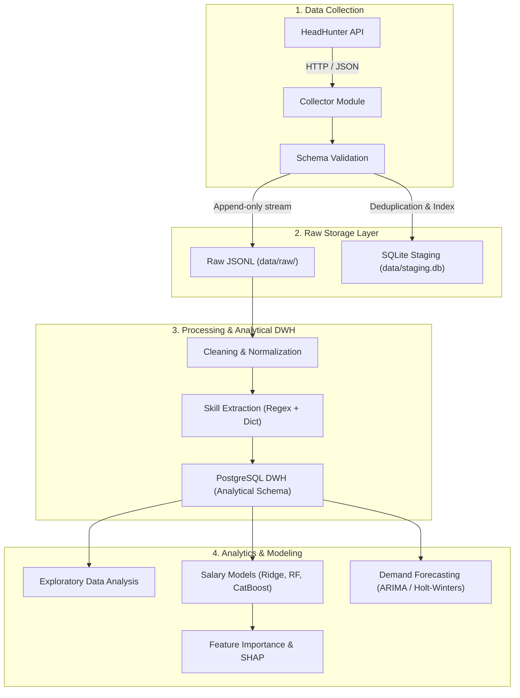

# JobPulse 📊
> **IT Job Market Analytics & Forecasting**  
> *Учебно-научное исследование рынка IT-вакансий стран СНГ средствами Python*

---

## 🎯 Научная тема исследования
> **«Автоматизированный анализ IT-вакансий СНГ средствами Python: оценка влияния навыков на заработную плату и прогнозирование спроса на них»**

Проект решает три задачи:
1. **Научная работа**: строгое статистическое и эконометрическое исследование связи технологических навыков с компенсацией и динамики спроса.
2. **Инженерный Data/ML-пайплайн**: production-like архитектура сбора, валидации, хранения (JSONL / SQLite / PostgreSQL), извлечения признаков и машинного обучения.
3. **Фундамент сервиса**: открытая модульная база для дальнейшего развития в веб-сервис мониторинга рынка труда.

---

## 🏗 Архитектура системы



---

## 📅 Календарный план (Roadmap)

| Этап | Содержание | Дедлайн | Статус |
|---|---|---|---|
| **Этап 1** | **Сбор данных и схема хранения** (API hh.ru, первичная валидация, JSONL / SQLite) | Октябрь | 🚀 *В процессе* |
| **Этап 2** | **Предобработка и извлечение признаков** (нормализация валют BYN, парсинг навыков) | 12 ноября | ⏳ Ожидание |
| **Этап 3** | **Статистический и регрессионный анализ зарплат** (EDA, регрессия, SHAP) | 26 ноября | ⏳ Ожидание |
| **Этап 4** | **Моделирование динамики спроса** (тренды Top-20 навыков, time series forecast) | 10 декабря | ⏳ Ожидание |
| **Этап 5** | **Оформление научной работы и упаковка** (статья, GitHub, документация) | 24 декабря | ⏳ Ожидание |

Подробный план со всеми подзадачами доступен в [`docs/ROADMAP.md`](docs/ROADMAP.md).

---

## 📂 Структура проекта

```text
jobpulse/
├── data/
│   ├── raw/               # Неизменяемые сырые выгрузки (JSONL)
│   ├── processed/         # Очищенные данные
│   └── staging.db         # Локальная база staging (SQLite)
├── src/
│   ├── collection/        # Сбор данных с API (клиент, пагинация, лимиты)
│   ├── storage/           # Сохранение (JSONL логгер, SQLite, PostgreSQL)
│   ├── preprocessing/     # Очистка текста, нормализация зарплат
│   ├── skills/            # Таксономия и извлечение навыков
│   ├── analysis/          # Статистический анализ и визуализации
│   ├── salary_model/      # Модели прогнозирования зарплат (ML)
│   └── demand_forecasting/# Анализ и прогнозирование временных рядов
├── docs/
│   ├── ROADMAP.md         # Детальный календарный график
│   └── DATA_SPECIFICATION.md # Спецификация критериев отбора и полей
├── notebooks/             # Исследовательские Jupyter-ноутбуки (EDA, эксперименты)
├── tests/                 # Автоматические тесты (pytest)
├── configs/               # Параметры сбора, списки ролей, словари навыков
├── .env.example           # Шаблон переменных окружения
├── pyproject.toml         # Манифест зависимостей проекта
└── README.md
```

---

## 🚀 Быстрый старт

### 1. Клонирование и установка зависимостей
Требуется **Python 3.12+**. Рекомендуется использовать современный пакетный менеджер [`uv`](https://github.com/astral-sh/uv):

```bash
git clone https://github.com/tarasssevich/jobPulse.git
cd jobpulse

# Создание виртуального окружения
uv venv --python 3.12

# Установка зависимостей проекта и инструментов разработки
uv pip install -e ".[dev]"
```

### 2. Настройка переменных окружения
Скопируйте шаблон конфигурации и заполните свои данные:
```bash
cp .env.example .env
```
> ⚠️ **Важно**: Никогда не коммитьте `.env` в репозиторий. Файл добавлен в `.gitignore`.

### 3. Запуск тестов
```bash
pytest
```

---

## ⚖️ Лицензия и этика данных
- Проект распространяется под лицензией **MIT**.
- Сбор данных выполняется исключительно через официальные публичные API в соответствии с условиями использования (Terms of Service) и вежливыми ограничениями по частоте запросов (Rate Limiting). Исходные персональные данные не сохраняются.
