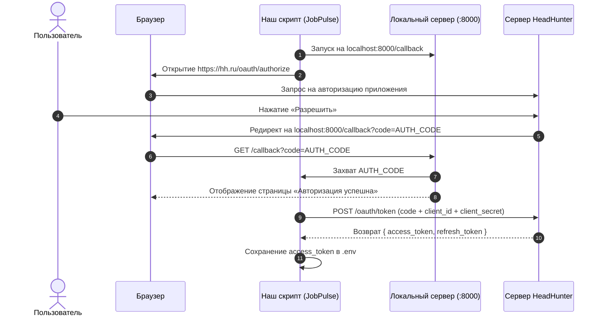

# 📘 Руководство инженера JobPulse: От синтаксиса до Production-архитектуры

> **Конспект для начинающего Python-разработчика и Data/ML-инженера.**  
> В этом документе разобраны все концепции, паттерны, архитектурные решения и тонкости, реализованные в системе **JobPulse**. Используй его как учебник и шпаргалку для подготовки к техническим собеседованиям.

---

## Содержание
1. [Устройство современного Python-проекта](#1-устройство-современного-python-проекта)
2. [Продвинутый Python 3.12: Паттерны и синтаксис](#2-продвинутый-python-312-паттерны-и-синтаксис)
3. [Инженерия данных и базы данных (JSONL & SQLite)](#3-инженерия-данных-и-базы-данных-jsonl--sqlite)
4. [Сетевая инженерия и устойчивость (HTTP & Resilience)](#4-сетевая-инженерия-и-устойчивость-http--resilience)
5. [Безопасность и OAuth 2.0 Авторизация](#5-безопасность-и-oauth-20-авторизация)
6. [Культура тестирования (Pytest, Fixtures, Mocking)](#6-культура-тестирования-pytest-fixtures-mocking)
7. [Шпаргалка для собеседования (Как презентовать этот проект)](#7-шпаргалка-для-собеседования-как-презентовать-этот-проект)

---

## 1. Устройство современного Python-проекта

### 1.1. Изоляция окружения: почему нельзя ставить пакеты глобально
- **Проблема**: Если устанавливать библиотеки через `pip install` глобально в ОС, со временем возникнет конфликт версий (Project A требует `pydantic 1.x`, а Project B — `pydantic 2.x`).
- **Решение**: Виртуальное окружение (`.venv`). Это изолированная папка, содержащая собственный интерпретатор Python и каталог `site-packages`.
- **Инструмент `uv`**: Мы используем менеджер пакетов нового поколения `uv` (написан на Rust). Он работает в 10–50 раз быстрее классического `pip` и умеет сам скачивать нужную версию Python (`uv venv --python 3.12`).

### 1.2. Стандарт конфигурации `pyproject.toml`
Забудь про устаревшие `setup.py` и `setup.cfg`. Согласно спецификациям PEP 517/518 и PEP 621, современный единый файл манифеста — это **`pyproject.toml`**.
В нем описаны:
- Метаданные (название, версия, минимальная версия Python `>=3.12`);
- Зависимости (`dependencies = [...]`);
- Группы для разработки (`[project.optional-dependencies] dev = [...]`);
- Конфигурации инструментов (линтер `ruff`, тестер `pytest`).

### 1.3. Editable Install (`pip install -e .`)
Команда `-e` (editable) устанавливает проект как локальный пакет. Это позволяет импортировать модули через абсолютные пути (`from src.storage.raw_storage import RawStorage`) из любого места (в тестах, скриптах, блокнотах), не мучаясь с `sys.path.append()`.

---

## 2. Продвинутый Python 3.12: Паттерны и синтаксис

### 2.1. Объектно-ориентированная работа с путями: `pathlib.Path`
Файл: [`src/utils/config.py`](file:///c:/jobPulse/src/utils/config.py)

```python
from pathlib import Path
BASE_DIR = Path(__file__).resolve().parent.parent.parent
DB_PATH = BASE_DIR / "data" / "staging.db"
```
- **Почему не `os.path`**: `os.path.join("a", "b")` — это работа со строками. `Path` — это полноценный объект файловой системы.
- **Перегрузка оператора `/`**: В `Path` переопределен магический метод `__truediv__`. Выражение `BASE_DIR / "data"` автоматически формирует правильный путь на любой ОС (с обратными слэшами на Windows и прямыми на Linux/macOS).

### 2.2. Иммутабельность: `@dataclass(frozen=True)`
Файл: [`src/utils/config.py`](file:///c:/jobPulse/src/utils/config.py)

```python
@dataclass(frozen=True)
class Settings:
    hh_client_id: str
```
- **Зачем нужен `@dataclass`**: Автоматически генерирует методы `__init__`, `__repr__`, `__eq__`. Тебе не нужно писать 20 строк boilerplate-кода.
- **Почему `frozen=True`**: Делает экземпляр неизменяемым. Попытка изменить поле `settings.hh_client_id = "new"` во время выполнения вызовет исключение `FrozenInstanceError`. Конфигурация в production не должна случайно мутировать.

### 2.3. Валидация входных данных: Pydantic v2
Файл: [`src/collection/schemas.py`](file:///c:/jobPulse/src/collection/schemas.py)

Словари (`dict`) в Python не защищают от ошибок: опечатка в ключе `data['slary']` приведет к падению в самый неожиданный момент.
Pydantic решает три фундаментальные задачи:
1. **Валидация типов в Runtime**: Если поле объявлено как `id: str`, а API прислало число `12345`, Pydantic мягко приведет его к строке или выбросит понятную ошибку `ValidationError`.
2. **Алиасы (`Field(alias="from")`)**: Слово `from` зарезервировано синтаксисом Python (`from math import pi`). Переменную нельзя так назвать. В Pydantic мы связываем JSON-ключ `"from"` с валидным питоновским именем `salary_from`.
3. **Безопасная фильтрация (`ConfigDict(extra="ignore")`)**: Защищает от изменений в стороннем API. Если HH добавит 50 новых полей, наша модель не упадет, а просто проигнорирует ненужные.

### 2.4. Потоковая обработка и генераторы (`yield`)
Файл: [`src/storage/raw_storage.py`](file:///c:/jobPulse/src/storage/raw_storage.py)

```python
def iter_raw_vacancies(self) -> Iterator[dict[str, Any]]:
    with self._get_connection() as conn:
        cursor = conn.execute("SELECT ... FROM raw_vacancies;")
        for row in cursor:
            yield {"vacancy_id": row["vacancy_id"], ...}
```
- **Разница между `return` и `yield`**:
  - `return list_of_items`: загружает ВСЕ строки из БД в оперативную память (RAM). Если в выборке 500 000 вакансий, память переполнится и процесс будет убит ОС (Out-Of-Memory Error).
  - `yield`: превращает функцию в **генератор** (ленивые вычисления). Данные считываются порционно, по одному элементу за раз. Сложность по памяти — $O(1)$.

---

## 3. Инженерия данных и базы данных (JSONL & SQLite)

### 3.1. Паттерн Write-Ahead Log (JSONL)
- **Что такое JSON Lines**: Текстовый файл, где каждая строка — это самостоятельный JSON-объект (`{"id": 1}\n{"id": 2}\n`).
- **Почему не один большой `.json`**:
  - Чтобы дописать объект в классический `[ {...}, {...} ]`, файл нужно полностью прочитать в память, распарсить, добавить элемент и перезаписать весь файл заново. При сбое питания в момент записи весь файл будет поврежден!
  - JSONL пишется в режиме `append` (`open(..., "a")`). Каждая вакансия мгновенно сбрасывается на диск. Это неизменяемый исторический слой сырых данных (Source of Truth).

### 3.2. SQLite как Staging Layer
- **WAL-режим (`PRAGMA journal_mode = WAL;`)**: Write-Ahead Logging позволяет читателям не блокировать писателей и наоборот. Это многократно повышает скорость конкурентной записи.
- **Идемпотентность (`INSERT OR IGNORE`)**:
  ```sql
  INSERT OR IGNORE INTO raw_vacancies (vacancy_id, payload_json) VALUES (?, ?);
  ```
  Если вакансия с таким ID уже есть, SQLite просто проигнорирует вставку. Это защищает базу от дублирования данных при повторных запусках пайплайна.

### 3.3. Безопасность SQL: Защита от SQL Injection
- ❌ **Уязвимый код**:
  ```python
  conn.execute(f"SELECT * FROM vacancies WHERE id = '{user_input}'")
  ```
  Если `user_input = "1' OR '1'='1"`, злоумышленник получит доступ ко всей базе.
- ✅ **Параметризованный запрос**:
  ```python
  conn.execute("SELECT * FROM vacancies WHERE id = ?", (user_input,))
  ```
  Драйвер БД отправляет SQL-структуру и данные отдельно. Подставить вредоносный код невозможно.

---

## 4. Сетевая инженерия и устойчивость (HTTP & Resilience)

Файл: [`src/collection/hh_client.py`](file:///c:/jobPulse/src/collection/hh_client.py)

В продакшене любая сеть ненадежна (пакеты теряются, серверы перегружаются). Простой вызов `requests.get()` без защиты быстро приведет к падению программы.

### 4.1. `requests.Session()` vs `requests.get()`
- Обычный `requests.get()` на каждый вызов создает новый TCP-сокет, выполняет тройное рукопожатие TCP (SYN, SYN-ACK, ACK) и согласование TLS/SSL.
- `requests.Session()` реализует **Connection Pooling** (пул соединений) и заголовок `Connection: keep-alive`. Одно соединение переиспользуется для сотен последующих запросов, ускоряя сбор данных в 3–5 раз.

### 4.2. Экспоненциальный Backoff и повторные запросы (Retries)
```python
retry_strategy = Retry(
    total=3,
    backoff_factor=1.0,
    status_forcelist=[500, 502, 503, 504],
)
```
- Если сервер возвращает ошибку `502 Bad Gateway` (временный сбой шлюза), библиотека не падает, а выжидает:
  $$\text{wait\_time} = \text{backoff\_factor} \times 2^{\text{attempt}}$$
  (1 секунда $\rightarrow$ 2 секунды $\rightarrow$ 4 секунды). Это дает удаленному серверу время восстановиться.

### 4.3. Ограничение частоты запросов (Throttling)
- Серверы защищаются от DDoS-атак. Если слать 50 запросов в секунду, тебя заблокируют (HTTP 429 Too Many Requests).
- Метод `_throttle()` гарантирует паузу между запросами (например, 0.35 секунды), имитируя естественный темп.

---

## 5. Безопасность и OAuth 2.0 Авторизация

Файл: [`src/collection/auth.py`](file:///c:/jobPulse/src/collection/auth.py)

### 5.1. Управление секретами (12-Factor App)
- **Правило №1**: Секреты (API Keys, Client Secret, пароли к БД) никогда не попадают в систему контроля версий.
- **Реализация**:
  - Файл `.env` добавлен в [`.gitignore`](file:///c:/jobPulse/.gitignore).
  - В репозитории хранится только публичный шаблон [`.env.example`](file:///c:/jobPulse/.env.example).

### 5.2. Как работает OAuth 2.0 Authorization Code Flow
Когда стороннее приложение запрашивает доступ к API от твоего имени, логин и пароль не передаются напрямую в приложение. Используется протокол делегирования доступа:



В нашем коде мы использовали встроенный в стандартную библиотеку `http.server.HTTPServer`, что позволило сделать авторизацию полностью автономной без сторонних тяжелых фреймворков.

---

## 6. Культура тестирования (Pytest, Fixtures, Mocking)

Файлы в каталоге [`tests/`](file:///c:/jobPulse/tests/)

Профессиональный инженер не считает задачу выполненной, пока код не покрыт тестами.

### 6.1. Изоляция от сети: библиотека `responses`
- **Золотое правило юнит-тестов**: Тесты должны выполняться за миллисекунды и работать даже в самолете без интернета.
- Библиотека `responses` перехватывает сетевой вызов `requests` на уровне Python-сокета и возвращает фиктивный ответ:
  ```python
  @responses.activate
  def test_api():
      responses.add(responses.GET, "https://api.hh.ru/...", json={"items": [...]})
  ```

### 6.2. Временные каталоги: фикстура `tmp_path`
- При тестировании базы данных нельзя писать в рабочий файл `data/staging.db`.
- Pytest предоставляет встроенную фикстуру `tmp_path` — это изолированная временная папка, создаваемая перед тестом и удаляемая после него.

### 6.3. Мокирование объектов: `unittest.mock.MagicMock`
- Если мы тестируем оркестратор (`VacancyCollector`), нам не нужно тестировать сам сетевой клиент. Мы заменяем его объектом-двойником (`MagicMock`), который возвращает заранее заготовленные данные. Это позволяет протестировать бизнес-логику оркестратора в полной изоляции.

---

## 7. Шпаргалка для собеседования (Как презентовать этот проект)

Когда на техническом интервью тебя спросят: *«Расскажи о самом интересном проекте, который ты написал на Python»*, используй эту структуру ответа:

### 1. Архитектурная формулировка (30 секунд)
> *«Я разработал ETL/ML-пайплайн JobPulse для мониторинга рынка IT-вакансий СНГ. Система состоит из трех слоев: сбор сырых данных с HeadHunter через отказоустойчивый HTTP-клиент, слой хранения (неизменяемый архив в JSONL и локальный staging в SQLite с автоматической дедупликацией), и слой аналитической витрины для последующего ML-моделирования зарплат и прогнозирования спроса на навыки».*

### 2. Ключевые инженерные вызовы, которые ты решил:
1. **Преодоление лимитов API**:
   *«API HeadHunter ограничивает поисковую выдачу 2 000 вакансиями. Чтобы собрать репрезентативную выборку в 5 000+ вакансий без потери качества, сборщик дробит запросы по странам СНГ (Беларусь, Россия, Казахстан), профессиональным ролям и временным окнам».*
2. **Отказоустойчивость сети**:
   *«Для HTTP-клиента я реализовал сессионный пул (Keep-Alive), вежливый троттлинг запросов для соблюдения rate limits и экспоненциальный backoff при временных ошибках 429 или 5xx».*
3. **Безопасность и авторизация**:
   *«Реализовал автоматический OAuth 2.0 Authorization Code flow со встроенным локальным HTTP-сервером на сокетах, который принимает callback от HH, обменивает код на Bearer-токен и безопасно сохраняет его в изолированный `.env`».*
4. **Эффективность по памяти**:
   *«В слое хранения используются генераторы (`yield`) и потоковая запись в JSONL, благодаря чему пайплайн потребляет константное количество памяти $O(1)$ независимо от объема данных».*
5. **Качество кода**:
   *«Кодовая база полностью типизирована, проверена линтером Ruff, а все критические модули покрыты изолированными тестами на Pytest с использованием моков (`responses`, `MagicMock`)».*

---
*Сохраняй этот конспект, перечитывай перед интервью и используй как шаблон для будущих проектов!*
